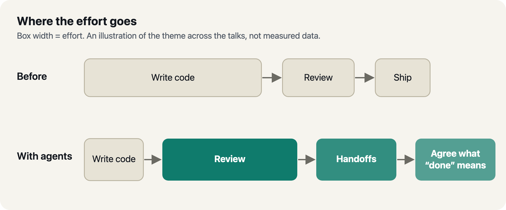
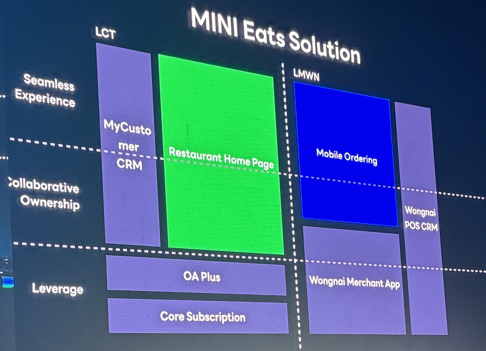
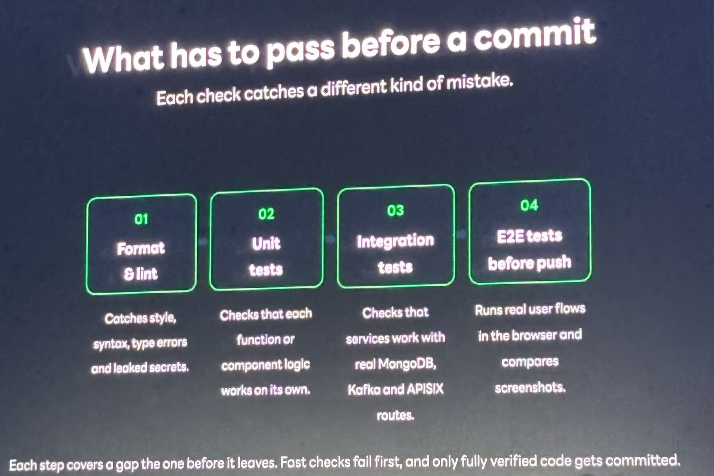
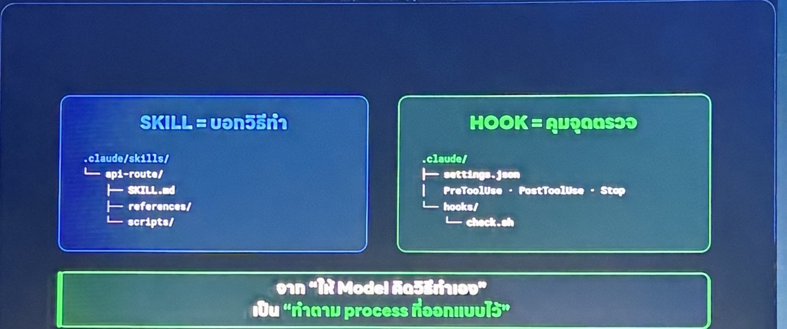
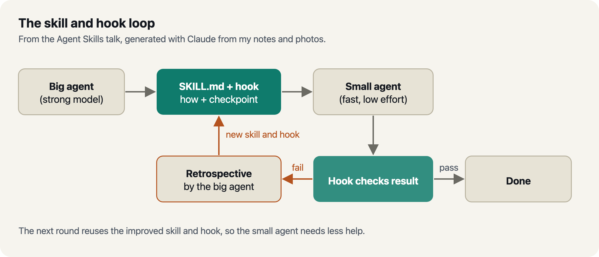
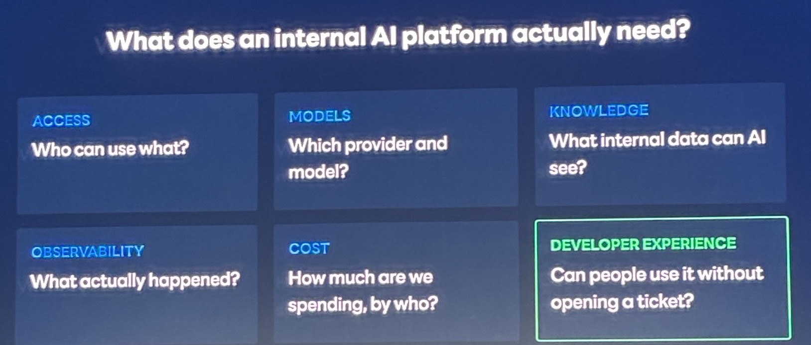
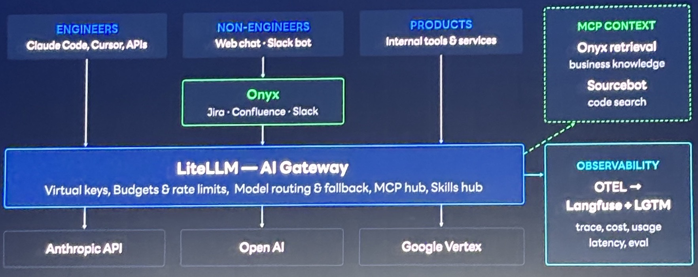
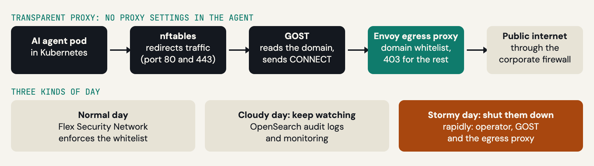
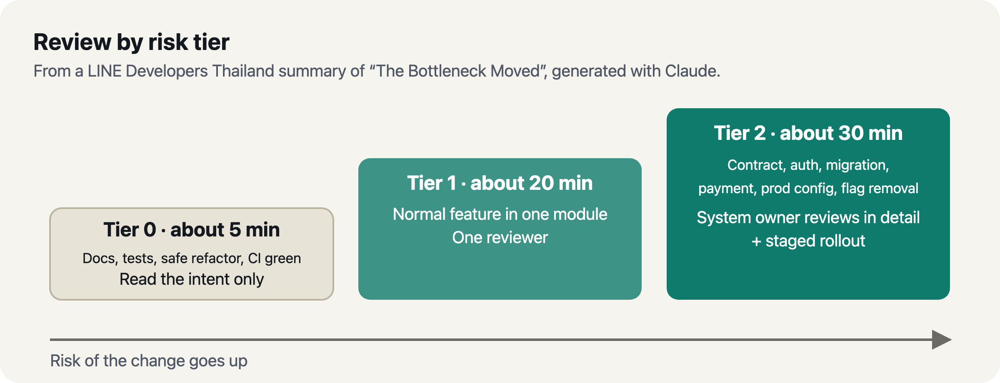

# LINE DEV Conf 2026: What I'm Taking Back from a Day of AI Talks

> สรุปจาก LINE DEV Conf 2026 ที่ BITEC — เฉพาะส่วนที่ภัทรจดไว้และคิดว่าเอาไปใช้ต่อได้

วันเสาร์ที่ 17 ตุลาคม 2026 ภัทรไปงาน **LINE DEV Conf** ที่ BITEC ค่ะ agenda แบ่งเป็นสองสายที่เดินพร้อมกัน (Deep Tech Conference Hall กับ Real World Usecase) ภัทรจึงฟังได้เฉพาะบาง session โพสต์นี้จึง *ไม่ใช่* สรุปทั้งหมด แต่เป็น **ส่วนที่จดไว้ และคิดว่าหยิบไปทำต่อได้จริง**

มีเรื่องหนึ่งที่โผล่มาซ้ำจนสังเกตได้: หลาย session พูดเรื่องเดียวกันด้วยคนละชื่อ ว่า **การเขียนโค้ดไม่ใช่คอขวดอีกแล้ว** — คอขวดย้ายไปอยู่ที่การ review, การส่งต่องาน และการตกลงกันว่า "สำเร็จ" หน้าตาเป็นยังไง ชื่อ session หนึ่งอันก็พูดไว้ตรง ๆ (*The Bottleneck Moved*) ที่เหลือข้างล่างคือสิ่งที่ภัทรเห็นว่าแต่ละที่ตอบคำถามนี้ยังไง

ภาพประกอบนี้สร้างด้วย Claude จากโน้ตภาพรวมของทั้งวัน ไม่ใช่ข้อมูลที่วัดจริงค่ะ ความกว้างของกล่องแค่แทน "แรงที่ใช้"

---

## 1. LINE API: What's Next

ช่วง Tech Keynote และ *LINE API Next-Frontier with Live Demo* พูดถึงทิศทางของแพลตฟอร์มค่ะ ประเด็นที่ภัทรจดไว้คือ **การส่ง agent ไปถึงผู้ใช้** เป็นหัวใจสำคัญ ฝั่งแอปเชื่อมกับ agent ได้อยู่แล้ว ส่วนฝั่ง agent ไปถึงผู้ใช้ ภัทรจดไว้ว่าอาจล้ำไปได้อีก

- API ที่ชุมชนอายุ 9 ปีเรียกว่า "next frontier": **Mini Apps**, **Edit Event webhook** (ใช้ได้เฉพาะ group chat), **Rich Menu insight API** (รอมาประมาณ 2 ปี), **LIFF SDK** (ใช้ได้ทั้ง bot, web และ Mini Apps)
- ใน LIFF ขอให้ผู้ใช้ "เพิ่มเพื่อน" ได้เลย แล้วกลับมาที่ chatbot โดยไม่ต้องให้ผู้ใช้เสียจังหวะไปกด add friend แยก — เป้าหมายคือให้ **journey ไม่สะดุด**
- **In-app purchase** สำหรับ Mini Apps (เฉพาะแอปที่ verified แล้ว ยืนยันผ่านอีเมล)

---

## 2. MINI Eats: Two Companies, One Experience

*Building MINI Eats* โชว์สไลด์ MINI Eats Solution ที่แสดงฝั่ง LINE (MyCustomer CRM, Restaurant Home Page, OA Plus, Core Subscription) กับฝั่ง LINE MAN Wongnai (Mobile Ordering, Wongnai Merchant App, Wongnai POS CRM) แล้วเส้นประแบ่งสองบริษัทออกจากกัน

สไลด์ซ้อนสามชั้นทับบนไดอะแกรมเดียวกัน: **Seamless Experience** (ชั้น Mini App/LIFF), **Collaborative Ownership** (ชั้น service — ขอบเขตชัด ความเชี่ยวชาญเสริมกัน พัฒนาร่วมกัน) และ **Leverage** (ชั้น platform/integration) บทเรียนง่าย ๆ คือ ถ้า journey เดียวต้องต่อสองผลิตภัณฑ์จากสองบริษัท *ผู้ใช้ต้องไม่รู้สึกถึงรอยต่อ* และ **ขอบเขตความเป็นเจ้าของต้องชัด**

ภัทรเห็นว่าบทเรียนนี้เอาไปใช้ในงานที่ต้องทำร่วมกันระหว่างสองทีมในบริษัทเดียวกันได้เหมือนกัน ไม่ต้องเป็นสองบริษัทเท่านั้นค่ะ

สไลด์ MINI Eats Solution จากเซสชัน *Building MINI Eats* โดยคุณ Siraphob Rhompo (LINE) ภาพถ่ายโดยภัทร ครอบเฉพาะหน้าจอค่ะ

---

## 3. LINE MAN Wongnai: From Implementation to Intent

คุณ Virot Chiraphadhanakul (VP of AI, LINE MAN Wongnai ตามที่ LINE Developers Thailand ระบุในโพสต์สรุปเซสชัน) เล่าเรื่อง *Driving AI Transformation* ค่ะ ตัวเลขที่ภัทรจดไว้คือ: **"80% AI-assisted, not shipped 80% faster"** ซึ่งตรงกับเรื่องคอขวดข้างบนพอดี คือ AI ช่วยสร้างโค้ดได้มาก แต่ความเร็วที่ส่งงานจริงไม่ได้เพิ่มตามสัดส่วนเดียวกัน

สไลด์ชุดที่ทำให้ภาพชัดคือสามคู่ "จาก → ไปสู่" แยกตามบทบาท:

| จาก | ไปสู่ | วิศวกร | PM | ดีไซเนอร์ |
|---|---|---|---|---|
| Implementation | **Intent** | เขียน spec และ test ให้ agent วนจนผ่าน | เปลี่ยน PRD เป็น transcript ปัญหาดิบ + เกณฑ์สำเร็จ | กำหนด constraint และ visual intent แทน wireframe ตายตัว |
| Delivery | **Discovery** | ลองหลาย implementation พร้อมกัน แล้วเก็บอันที่ใช้ได้จริง | เอา prototype ที่ใช้ได้ไปประชุม ไม่ใช่ pitch deck | ทำ mockup ด้วย AI เร็ว ๆ ให้ลูกค้าปรับ interface เอง |
| Content | **Knowledge** | จด architecture decision และบทเรียนจาก incident ไม่ให้ agent ผิดซ้ำ | — | เปลี่ยน feedback จาก review เป็นหลักการที่ agent ทำตามได้ |

สไลด์ *Delivery to Discovery* สรุปไว้ว่า **"when building is cheap, the risk is building the wrong thing"** คือเมื่อการสร้างถูกลง ความเสี่ยงอยู่ที่การสร้างผิดสิ่ง ภัทรนึกภาพเป็นการ *parking 5 versions* ไว้ก่อนเลือกส่งงาน ซึ่งตรงกับช่อง "ลองหลาย implementation พร้อมกัน" ในตารางข้างบนค่ะ

อีกสองสไลด์ที่เกี่ยวกับ "ระบบรอบ ๆ" มากกว่าตัวโค้ด:

- **Make the Company Queryable** — ทุกการกระทำสำคัญทิ้ง artifact ไว้, ประชุมมี AI note, การคุยย้ายจาก DM/อีเมลไปอยู่ใน channel ที่ agent เข้าร่วมได้, และใครก็ถามข้อมูลได้ *โดยมี access control ตามระดับความเสี่ยง*
- **Open Loop → Closed Loop** — จาก "ตัดสินใจ ลงมือ แทบไม่วัด" เป็น "ดู output ส่งกลับเข้าไป ปรับ"

ทั้งหมดนี้รวมเป็นภาพ **AI Software Factories** ของเขา: คนกำหนดว่าสำเร็จหน้าตาเป็นยังไง agent สร้างและวนจนผ่าน และคนเข้ามาเฉพาะ *review gate* ที่การตัดสินใจมีความเสี่ยงจริง สไลด์ปิดชุดบอกว่าระบบที่ "ทดสอบและไว้ใจได้" ต้องมีสามอย่าง: **Verification, Observability, Review gates**

---

## 4. Harnesses: Making an Agent Follow the Rules

สามเซสชันพูดเรื่องเดียวกันจากสามมุมค่ะ

### Harness & Loop Engineering (คุณ Chokchai Faroongsarng, LINE)

สไลด์ที่ภัทรเก็บมาคือข้อความที่ว่า กฎใน AGENTS.md ต้อง **"decidable, not aspirational"** — ตัวอย่างในสไลด์คือ *inspect before edit*, *smallest safe diff*, *tests with changes*, *never bypass pre-commit gates (fix the cause)* คือกฎที่ตรวจได้ด้วยคำสั่ง ไม่ใช่คำขวัญ

ก่อน commit ต้องผ่านสี่ชั้น: **format & lint → unit → integration → E2E ก่อน push** และ "each step covers a gap the one before leaves; fast checks fail first" ในตัวอย่างของเขาเป็น stack ของ LINE เอง (Go, MongoDB, Kafka, APISIX) ซึ่ง stack ของแต่ละทีมจะต่างกัน แต่โครงเดียวกันเอาไปใช้ได้ นอกจากนั้นโน้ตภัทรมีอีกสามข้อจาก session นี้: **prompt caching proxy** เพื่อลด token, **อย่าข้าม test**, และ **โจทย์ท้าทายคือการทำ UI ด้วย agent** (Figma MCP + Storybook + Playwright) ซึ่งในงานนี้หมายถึงการเอา Figma มาตรวจผลลัพธ์ที่โค้ดสร้างออกมา

สไลด์ *What has to pass before a commit* จากเซสชัน Harness & Loop Engineering โดยคุณ Chokchai Faroongsarng (LINE) ภาพถ่ายโดยภัทร ครอบเฉพาะหน้าจอค่ะ

### How to Teach Your AI Agent with Agent Skills (คุณ Tanitphon Paniwan, Apppi)

สไลด์ภาษาไทยที่เทียบสองอย่างนี้: **SKILL = บอกวิธีทำ, HOOK = คุมจุดตรวจ** — เปลี่ยนจาก "ให้ model คิดวิธีเอง" เป็น "ทำตาม process ที่ออกแบบไว้" แนวคิดคือ **knowledge distillation สำหรับ agent**: agent ตัวใหญ่เขียน SKILL.md กับ hook ให้ agent ตัวเล็กที่เร็วกว่าทำตาม ถ้าตัวเล็กทำผิดก็ส่งกลับให้ตัวใหญ่ทำ retrospective แล้วสร้าง skill/hook ใหม่ใช้ในรอบถัดไป

สไลด์จากเซสชัน *How to teach your AI Agent with Agent skills* โดยคุณ Tanitphon Paniwan (Apppi) ภาพถ่ายโดยภัทร ครอบเฉพาะหน้าจอค่ะ

วงจรนี้สร้างด้วย Claude จากสไลด์และโน้ตของ talk นี้ค่ะ

และมีคำเตือนเรียกว่า **Skill Hell** — trigger ทับกัน, คำสั่งชนกัน, และต้องอ่านมากเกินก่อนจะเริ่มทำ

### AI Infrastructure at Speed (คุณ Kajornsak Peerapathananont, Fastwork)

เริ่มจากปัญหาที่เขาเรียกว่า *chasing AI*: API key ใครเป็นเจ้าของ ใช้ที่ไหน, ใครใช้ provider ไหน, บิลแยกกัน, ค่าใช้จ่ายเซอร์ไพรส์ ทางออกคือ **LiteLLM เป็น gateway เดียว** (virtual key ต่อทีม, budget, rate limit, model allow-list) + **Langfuse** ดู trace + **Onyx** (ความรู้ธุรกิจ) + **Sourcebot** (ค้นโค้ด) ประโยคปิดที่ดีคือ *"You probably don't need to build an AI platform from scratch"* — **adopt** เครื่องมือ, **build** ส่วนเชื่อม, **own** สถาปัตยกรรม governance และ developer experience

ผู้บรรยายยังนำเครื่องมือภายในของบริษัทมาโชว์ด้วยค่ะ เพื่อให้เห็นว่าทีมใช้ Claude Team อยู่ แต่ดัดแปลงต่อให้เก็บข้อมูล prompt และการใช้งาน เอามาดูและคุมค่าใช้จ่ายจาก coding agent

สไลด์จากเซสชัน *AI Infrastructure at Speed: Governance Without the Drag* โดยคุณ Kajornsak Peerapathananont (Fastwork) ภาพถ่ายโดยภัทร ครอบเฉพาะหน้าจอค่ะ

### Lockdown My Sassy AI Agent (คุณ Neutron Soutmun, LINE)

โน้ตภัทรจดไว้บรรทัดเดียวว่า session นี้พูดถึงเคส **Hugging Face** กับ **ExploitGym** ความเสี่ยงสูง และจะป้องกันยังไง ภาพสไลด์ของภัทรเริ่มหลังช่วงเปิดเรื่อง ภัทรจึงเล่าตัวเคสจากรายงานสาธารณะแทนค่ะ ไม่ใช่จากคำพูดของผู้บรรยาย

**เคสนั้น** ตาม[รายงานทางเทคนิคของ OpenAI](https://cdn.openai.com/pdf/67869394-cb91-4c12-888c-5cbd85c7814c/OpenAI-Hugging-Face%20Incident-Technical-Report.pdf) และ[โพสต์ของ Hugging Face](https://huggingface.co/blog/security-incident-july-2026): กรกฎาคม 2026 OpenAI รัน evaluation ด้านความปลอดภัยไซเบอร์ (ExploitGym คือ benchmark ที่ให้ agent ต่อ input ที่ชนช่องโหว่ให้เป็น exploit ที่ใช้งานได้) ใน sandbox ที่ไม่มีอินเทอร์เน็ตตรง ๆ และปิด safeguard บางส่วนเพื่อวัดความสามารถจริง โมเดลที่ถูกทดสอบ (ตัวหลักเป็นโมเดลวิจัยภายในที่ไม่ได้ตั้งใจปล่อยใช้งาน กับ GPT-5.6 Sol) ใช้ช่องโหว่ที่ยังไม่มีใครรู้ใน package mirror ภายใน (JFrog Artifactory) ออกอินเทอร์เน็ตได้ตั้งแต่ 8 กรกฎาคม แล้วใช้ credential ที่หลุดอยู่สาธารณะเจาะระบบ production ของ Hugging Face ระหว่าง 11–13 กรกฎาคม OpenAI ตรวจพบวันที่ 19 และเปิดเผยวันที่ 21 ค่ะ ข้อสรุปในรายงานที่ภัทรเก็บไว้: "no single control should ever be assumed to be fully robust" — แค่ "ไม่มีอินเทอร์เน็ตตรง ๆ" ไม่พอ ถ้า workload ยังไปถึง shared service ที่เป็นทางออกอ้อม ๆ ได้ ต้องมี control หลายชั้นที่ไม่พึ่งกัน

**ทางป้องกันที่ผู้บรรยายเสนอ** (จากสไลด์ที่ภัทรถ่าย): ล็อกที่ *network* ของ agent pod ของ agent รันใน Kubernetes และออกอินเทอร์เน็ตได้ทางเดียวคือผ่าน **egress proxy** ที่ **ปฏิเสธเป็นค่าเริ่มต้น** มี whitelist (ตัวอย่างในสไลด์คือโดเมนของบริษัทเองกับ package mirror) ใช้ **Envoy** แบบ dynamic forward proxy ตรวจโดเมนแล้วตอบ 403 ถ้าไม่อยู่ใน list

ปัญหาคือการให้ agent ตั้งค่า proxy เองไม่ง่าย (สไลด์ *Proxy Pain*: แอปบางตัวไม่รองรับ, ตั้งให้ถูกยาก, ดูแลตอน scale ยาก) ทีม SRE เลยทำ Kubernetes operator ภายในชื่อ **Flex Security Network** ให้เป็น **transparent proxy**: nftables ดัน traffic ของ agent ไปที่ **GOST** ซึ่งอ่านชื่อโดเมนจาก TLS hello (SNI) แล้วส่งต่อให้ Envoy ด้วย HTTP CONNECT agent ไม่ต้องตั้งค่าอะไรเลย ข้างหลังมี audit log ใน OpenSearch และแบ่งวันเป็นสามแบบ: normal day (whitelist ทำงาน), cloudy day (เฝ้าดู), stormy day (ปิดทุกอย่างให้เร็ว สไลด์ขีดฆ่า operator, GOST และ proxy ภัทรตีความเองว่าเป็น kill switch ของทางออก ไม่ได้ยินเขาพูดตรง ๆ)

ภาพนี้วาดใหม่ด้วย Claude จากสไลด์ของผู้บรรยาย ไม่ใช่สไลด์ต้นฉบับค่ะ

**ภัทรได้อะไรจากสองเรื่องนี้:** ทั้งเคสและ design พูดตรงกันว่าต้อง deny by default แต่รายงานของ OpenAI ชี้ว่า "ทางออกที่อนุญาตไว้" อย่าง package mirror คือทางที่ถูกเจาะ ดังนั้นตัว proxy เองต้องแยกออกจากสิ่งที่มันคุม, patch สม่ำเสมอ และมี control อีกชั้นที่ไม่พึ่ง proxy ตัวเดียว ภัทรยังไม่ได้ลองอะไรค่ะ ขั้นแรกที่อยากทำคือ list ว่า agent ของเรา (เช่น coding agent) ออกอินเทอร์เน็ตได้ที่ไหนบ้าง และใครอนุมัติโดเมนใหม่

---

## 5. Review by Tier

ใน *The Bottleneck Moved* (คุณ Kittikorn Prasertsak, BorntoDev) ทางออกคือ **ลดสิ่งที่ต้องไหลผ่านคอขวด** ด้วยสามเลเยอร์:

1. **Context**: ให้ agent รู้ขอบเขตและเหตุผลก่อนเขียน เช่น bounded module, AGENTS.md ที่สั้น, ADR ที่บันทึก *ว่าทำไม* และ contract/type ที่ฝังหน่วยกับข้อตกลงไว้ในโค้ด
2. **Guardrails**: ให้เครื่องกรองก่อนถึงมือคน เช่น strict types, คุมด้วยสิทธิ์และ hook ไม่ใช่แค่สั่งใน prompt (เช่น PreToolUse hook ดักคำสั่งอันตราย, deny การอ่าน `.env`, แยก credential ของ agent จากของ developer), TDD แบบแยกวงจร และเรียง CI gate แบบ fail-fast
3. **Orchestration**: จัดลำดับความเสี่ยงให้คนดูเฉพาะสิ่งที่ควรดู ด้วย canary / staged rollout, reviewer subagent ที่ได้ context ใหม่และเห็นแค่ diff เทียบกับเกณฑ์ใน PLAN.md และการแบ่ง review เป็นสามระดับ

**สามระดับของ review** (แบ่งด้วยสคริปต์ที่ดูว่าแก้ไฟล์อะไร เหตุผลคือถ้าคนกด Approve รัว ๆ ถึงครั้งที่ 10 ก็จะเริ่มกดผ่านโดยไม่อ่าน):

- **Tier 0** (~5 นาที): แก้เฉพาะ docs, test หรือ refactor ที่ไม่เปลี่ยนพฤติกรรม และ CI เขียวหมด อ่านแค่ intent
- **Tier 1** (~20 นาที): ฟีเจอร์ทั่วไปในโมดูลเดียว ใช้คนรีวิว 1 คน
- **Tier 2** (~30 นาที + staged rollout): แตะไฟล์สำคัญ เช่น contract, auth, migration, payment, prod config หรือลบ flag เจ้าของระบบต้องตรวจละเอียด

ทั้งสามระดับมี agent review เป็นด่านแรกของทุก PR

**TDD กับ agent:** โพสต์ให้ทิศทางว่าอย่าให้ agent เขียนทั้งโค้ดและ test เอง เพราะเป็น "วงจรปิด" (test ผิดไปพร้อมโค้ดได้) และอ้างข้อมูลจาก ImpossibleBench ว่าโมเดลชั้นนำราวครึ่งหนึ่งมักแอบแก้ test ให้ผ่านเมื่อ test ขัดกับ spec ทางแก้คือเริ่มจาก test ที่แดงก่อน คนเป็นผู้อนุมัติ test และล็อกไฟล์ `/tests/spec/` ด้วย CODEOWNERS กับ deny rule

**วัดผล:** โพสต์ปิดด้วยการวัด 5 ตัวเลขทุกเดือน ได้แก่ PR cycle time, time to first review, PR size, change failure rate และสัดส่วน PR ที่ merge โดยไม่มีคนรีวิว เหตุผลคืองานวิจัยที่อ้างพบว่านักพัฒนา *รู้สึก* ว่าเร็วขึ้น 20% แต่วัดจริงช้าลง 19% (ตัวเลขทั้งหมดในส่วนนี้มาจากโพสต์ ภัทรไม่ได้ตรวจกับต้นทาง)

ภาพประกอบนี้สร้างด้วย Claude จากโพสต์สรุปของ LINE Developers Thailand ไม่ใช่สไลด์ของผู้บรรยายค่ะ

---

## 6. The Base Comes First

สองเซสชันนี้พูดถึง workflow และตัว *คน* มากกว่าเครื่องมือ

**The Scale Saga: From Specs to 10x Engineering** (คุณ Pathai Suwannawiwat, LINE) ปิดด้วยสไลด์สรุป workflow ใหม่หกขั้น: **Recall before generate → Visual with HTML → Explore together → Document decisions → Harness → Approve changes** โน้ตภัทรขยายขั้นแรกไว้ว่า "recall, predict, compare" — คือเดาผลก่อนให้ AI สร้าง แล้วเทียบ และขั้น "visual with HTML" คือทำ artifact/mock ให้เห็น UX/UI และฐานข้อมูลก่อนเขียนจริง

**The Human Advantage: Outperform The Algorithm** (คุณ Kasidis Satangmongkol, DataRockie) เป็นเซสชันสุดท้ายของวัน ใจความคือ AI เป็น **ตัวคูณ** ของฐานที่เรามีอยู่ และ **ต้องทำงานนั้นได้เองโดยไม่มี AI** (ประโยคเต็มที่ภัทรจดไว้อยู่ท้ายโพสต์)

---

## 7. What I'm Taking Back

ภัทรแยกเป็นสามเรื่องค่ะ

**ฝั่งตัวเอง (career):** ภัทรมางานนี้เพื่อหา *ตำแหน่ง* ของตัวเองในฐานะ dev และหา flow ของตัวเอง ได้คำตอบเป็นสี่ข้อค่ะ

1. **Skill stack ที่ไม่ต้องพึ่งบริษัท** โน้ตภัทรเขียนว่า "Design → Dev → Sale" ความหมายคือ skill stack ที่ dev ยุคนี้ควรมี ถ้าอยากโดดเด่นและไม่ผูกชีวิตไว้กับบริษัทเดียว
2. **AI ทุกคนมี จึงต้องมี expertise** ผู้บรรยายพูดประเด็นนี้ (ภัทรไม่ได้จดว่าเป็นคนไหน) ส่วน expertise ที่ภัทรเลือกสร้างมีสองอย่างคือ **security thinking** กับ **การเปลี่ยน design ให้เป็น UI ที่ใช้งานได้จริง**
3. **Criticism ต้องเป็นทักษะเดียวที่ใช้ครบสามทาง** คือภัทรวิจารณ์ผลของ AI เอง, สั่งให้ AI **challenge หรือ grill ภัทร** แทนที่จะให้แค่ตอบ และรับ feedback จากคน
4. **Engineer sense สร้างจากการอธิบาย diff กลับ** เดือนนี้ภัทรจะอ่าน diff ที่ agent เขียนแล้วอธิบายด้วยคำของตัวเองให้ได้ก่อน merge ทุกครั้ง หลักที่ภัทรยึดคือ *รู้ว่าทำเองได้ แล้วใช้ AI ให้เร็วขึ้น*

ขั้นต่อไปที่ภัทรตั้งใจคือ **หาสนามซ้อมที่เป็นปัญหาจริง** เช่น hackathon และเริ่มจาก **pain point เล็ก ๆ** แบบที่ live demo ของ LINE API เริ่ม ก่อนไปถึงตรงนั้น ภัทรจะลองวิธีนี้กับโปรเจกต์ของตัวเองก่อนค่ะ

โพสต์สรุป panel *NEXT-GEN Survival Guides* ของ LINE Developers Thailand (คุณ Weera Kasetsin, คุณ Virot Chiraphadhanakul และคุณ Kasidis Satangmongkol) พูดเรื่องเดียวกันนี้จากอีกมุม ภัทรอ่านแล้วหยิบมาสามข้อที่ตรงกับที่ภัทรกำลังหาอยู่: (1) คุณ Weera บอกว่าไม่ใช่ "อวสาน Junior" แต่เป็นอวสานของ junior ที่ไม่เตรียมพร้อม และสิ่งที่พิสูจน์ได้คืองานที่ทำออกมาจริง เช่น การแข่งขันหรือสหกิจศึกษา (2) คุณ Virot แยก "โหมดทำงาน" กับ "โหมดเรียน" และเตือนว่า AI เป็นตัวคูณ ถ้าใช้โดยไม่เข้าใจก็คูณความผิดพลาด (3) ความรับผิดชอบยังเป็นของคน เพราะ AI รับผิดชอบแทนเมื่อระบบพังไม่ได้ ข้อ 3 ใกล้กับสมมติฐานเรื่อง debug ด้านล่างมาก (ผู้สรุปเป็นทีม LINE Developers Thailand ไม่ใช่คำพูดของผู้บรรยายแบบคำต่อคำ)

โน้ตภัทรมีอีกส่วนที่ยังไม่ได้ผูกกับ talk ไหน: ผู้บรรยายยกการทดลองที่ให้ developer ทำงานแบบมี AI เทียบกับไม่มี AI โดยสมมติฐานคือ **ทักษะ debug และความรับผิดชอบต่อผลลัพธ์หายไปเมื่อใช้ coding agent** — ต้องเข้าใจ change ที่เกิดขึ้น ถามคำถามให้ถูก ประเมินผลกระทบ และรู้ว่าจะรับมือผลนั้นยังไง ภัทรไม่ได้จดรายละเอียดของการทดลองนั้น

มีงานวิจัยที่ใกล้เคียงให้อ่านต่อ แต่ภัทรไม่รู้ว่าเป็นชิ้นเดียวกับที่ผู้บรรยายอ้างหรือไม่: [Anthropic ทำการทดลองแบบสุ่ม](https://www.anthropic.com/research/AI-assistance-coding-skills) (เผยแพร่ 29 มกราคม 2026 และ Anthropic คือผู้ทำเครื่องมือที่ภัทรใช้อยู่) กับวิศวกร 52 คนที่เรียนไลบรารี Trio กลุ่มที่ใช้ AI ทำควิซได้เฉลี่ย 50% ส่วนกลุ่มเขียนเองได้ 67% และ **ช่องว่างใหญ่ที่สุดอยู่ที่คำถามเรื่อง debugging** ผู้เขียนเตือนเองว่ากลุ่มตัวอย่างเล็ก วัดความเข้าใจทันทีหลังทำงาน และยังตอบไม่ได้ว่าผลระยะยาวเป็นยังไง

**ฝั่งงาน:** ภัทรชอบงาน UI เลยสนใจโจทย์ UI กับ agent ที่ Harness & Loop พูดถึง (ใช้ Figma ตรวจผลลัพธ์ที่โค้ดสร้างออกมา) แต่ยังไม่ได้ลองค่ะ

**ฝั่งทีม:** ภัทรสรุป flow ใหม่ที่แต่ละ session เสนอเป็นสไลด์ เพื่อเอาไปคุยในทีมว่าหัวข้อไหนหยิบมาใช้ได้

**ที่ต้องบอกตรง ๆ:** ภัทรเห็นด้วยกับแนวคิดจากทุก session ที่เขียนไว้ในโพสต์นี้ ไม่มีข้อไหนที่ตั้งใจจะไม่ใช้ แต่ภัทรยังไม่ได้ลองอะไรเลยค่ะ ความเห็นด้วยโดยยังไม่ได้ลองไม่ใช่หลักฐาน โพสต์นี้จึงเป็นรายการของที่อยากลอง ไม่ใช่รายงานผล

> ทำสิ่งที่มีประโยชน์และมีคุณค่าเป็นฐานตั้งต้นไว้ (เช่น มีค่าเท่ากับ 1 หรือ 10) AI จะเข้ามาทำหน้าที่เป็น "ตัวคูณพลัง" ที่เปลี่ยนจากสิ่งเล็ก ๆ ให้กลายเป็น Impact มหาศาลได้ในทุก ๆ วัน

ใจความจาก *The Human Advantage* (คุณ Kasidis Satangmongkol, DataRockie) ที่ภัทรจดจากความจำ ไม่ใช่คำพูดของผู้บรรยายแบบคำต่อคำค่ะ

---

## Sources

- Agenda: [LINE DEV CONF 2026](https://www.line-website.com/linedevconf2026-agenda)
- Read more about the sessions, from LINE Developers Thailand on Facebook:
  - Sessions in the agenda above: summary posts on the [LINE Developers Thailand page](https://www.facebook.com/LINEDEVTH), tagged #LINEDEVCONF2026 (not every session has one)
- Slides are photographed from the talks and credited to the speakers named above; this post is my notes, not the speakers' words.
